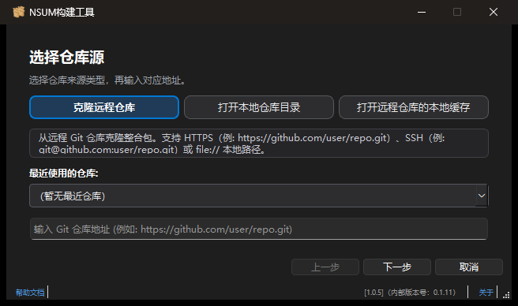

# 主程序界面



NSUM 主程序（`NeoServerUpdateModpack.exe`，不带参数启动）是整合包作者的图形化构建工具；玩家侧主要使用 HMCL 的 NSUM 页面。本页说明主程序 GUI 的常用界面。

## 启动方式

```powershell
# 打开 GUI
.\NeoServerUpdateModpack.exe

# 指定仓库直接进入
.\NeoServerUpdateModpack.exe --repo <仓库路径>
```

## 构建向导

向导按顺序收集构建参数，每一步都可以返回修改：

| 页面 | 内容 |
|---|---|
| 仓库 | 选择本地仓库、克隆远程仓库、从历史记录打开 |
| 分支 | 选择 **整合包分支**（构建依据） |
| 整合包 | 选择要构建的整合包（来自 `workspace.json` 的 branches） |
| 导出类型 | MCBBS / Modrinth / HMCL / NSUM（`.nsumpack`） |
| 导出目录 | 选择输出位置；HMCL 格式为同步目录 |
| 额外信息 | 导出器声明的字段（名称、版本、作者、描述、内嵌规则等） |
| 检查清单 | 汇总将要执行的操作，确认后开始构建 |
| 构建 | 实时日志、总进度、子任务进度、取消按钮 |
| 完成 | 结果、警告、打开输出目录/帮助文档 |

### 构建页

- **总进度条**：构建阶段（克隆 → 合并 → 下载 → 导出）；
- **子进度条**：下载/同步等并行子任务（例如指针下载、文件复制）；
- **日志区**：可折叠，包含完整构建日志；
- **取消**：安全取消当前构建（已下载缓存保留）。

### 完成页

- 成功：显示输出路径与警告数量；
- 失败：显示错误摘要与「打开帮助文档」按钮；
- 警告：通常是可选文件缺失、指针解析失败等，可在日志中定位。

## 历史与缓存

- 「仓库 → 历史」保存最近打开的仓库（本地/远程/缓存）；
- 远程仓库会缓存在 `config/history/cache/`，再次打开先 fetch；
- 构建缓存位于系统临时目录/缓存目录，指针文件按 SHA-256 复用。

## 设置

| 设置 | 说明 |
|---|---|
| Git 路径 | 默认使用内置 Git（`tools/git`）；缺失时回退系统 Git |
| 日志级别 | `NSUM_LOG_LEVEL=trace/debug/info/warn/error/off` |
| 语言 | 界面中文；CLI 输出英文 |

## 常用命令行等价物

```powershell
# 列出仓库的整合包分支
.\NeoServerUpdateModpack.exe info modpacks --repo <仓库> --json

# 预览构建结构
.\NeoServerUpdateModpack.exe info preview --repo <仓库> --modpack base --format nsum --json

# 无界面构建并导出
.\NeoServerUpdateModpack.exe exec build --repo <仓库> --modpack base --git-branch main --format nsum --export out.nsumpack
```
