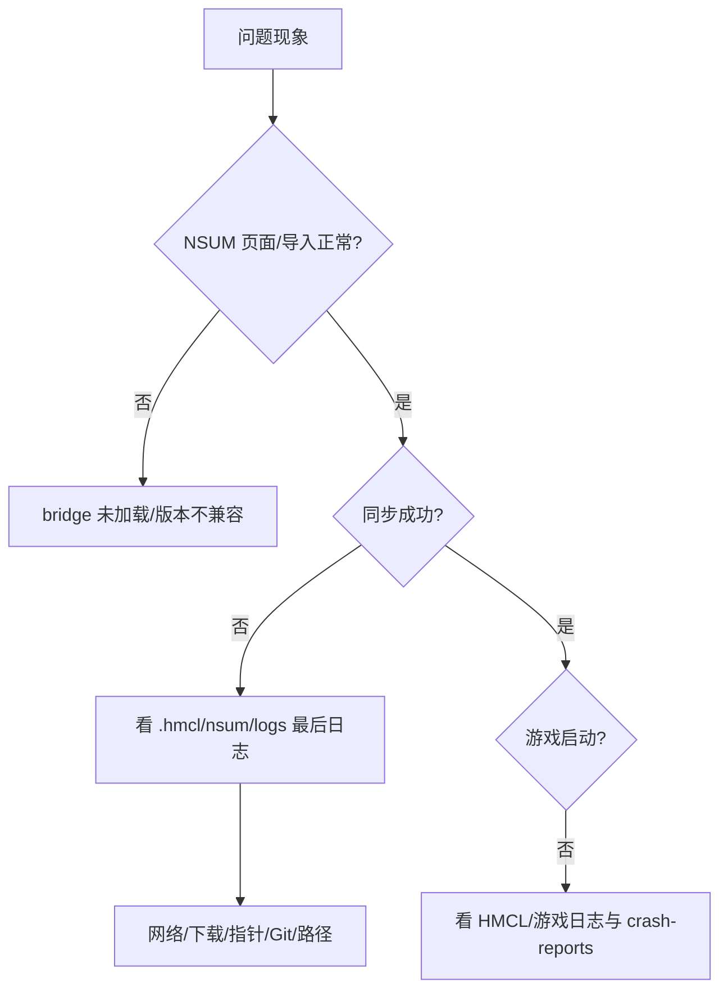

# 故障排查

先确定问题发生在哪一层：**HMCL/bridge** → **Runtime 同步** → **游戏启动**。每层都有独立日志。

## 日志位置

| 日志 | 位置 |
|---|---|
| Runtime 构建日志 | Runtime 运行目录 `builder.log` |
| bridge 同步日志 | `<HMCL>/.hmcl/nsum/logs/` |
| HMCL 日志 | HMCL 自身日志目录 |
| 游戏崩溃 | 实例 `crash-reports/` |

## 分诊树



## 症状一：安装 Runtime 卡在 0 B/s 或下载失败

**日志关键字**：`download`、`timeout`、`HTTP 502`、`curl`。

原因：代理/网络对大文件并发不友好；GitHub 限速。

处理：

1. 重试（并行下载失败会自动回退单流）；
2. 手动下载 Runtime zip，放入 `.hmcl/nsum/downloads/`，在 NSUM 页面点「从 downloads 安装」；
3. 检查代理/防火墙；确认 metadata 站点可访问。

## 症状二：同步失败（下载/指针）

**日志关键字**：`PointerDownloader`、`resolve_url`、`SHA-256`、`No resolver`。

| 关键字 | 原因 | 处理 |
|---|---|---|
| `No resolver found` | 指针解析器未加载/类型未知 | 检查 `pointers/` 插件是否存在；确认 resolver 名称 |
| `SHA-256 hash mismatch` | 下载内容损坏/被篡改 | 删除缓存文件重试 |
| `Download failed` | 网络/URL 失效 | 检查 URL 与网络 |

## 症状三：分支切换失败

**日志关键字**：`pathspec ... did not match`、`checkout failed`。

原因：Git 分支名与整合包分支名混淆；远程分支不存在。

处理：在分支选择对话框重新选择 Git 分支；确认仓库有该分支。

## 症状四：游戏启动崩溃

1. 确认同步任务成功（否则先修同步）；
2. 检查 Java 版本（HMCL 实例设置）；
3. 检查游戏版本/加载器（NeoForge/Fabric）是否与服务器一致；
4. 查看 `crash-reports` 与 HMCL 日志；
5. 删除冲突模组（服务器要求之外的客户端模组）。

## 症状五：中文/Unicode 路径异常

**日志关键字**：`No mapping for the Unicode character`、退出码 `-1073740791`（0xC0000409）。

原因：旧版本 ANSI argv/路径处理缺陷。

处理：更新到 Runtime ≥ 1.0.3；仍出现时把仓库/实例移到纯英文路径并反馈。

## 症状六：HMCL 中没有 NSUM 页面

- 确认 `mods/nsum-bridge-*.jar` 存在且未被禁用；
- 确认 HMCL 版本满足 bridge 要求；
- 查看 HMCL 日志中 bridge 加载错误（缺少 FLF API 依赖）。

## 症状七：内置 Git 不可用

```powershell
.\NeoServerUpdateModpack.exe info git
.\NeoServerUpdateModpack.exe exec git-update
```

若仍失败，检查 `install.conf` 的 `git_path`，或安装系统 Git 作为兜底。

## 症状八：MCLHR 投影失败

**日志关键字**：`mclhr`、`mc mods sync`。

- 确认 `<runtime>/tools/mclhr/mclhr.jar` 存在；
- 查看 bridge 日志中的命令与退出码；
- 不影响游戏启动时可能只是跳过（视配置）。

## FLFHMCL 兼容

<!-- slot:FLFHMCL_COMPAT -->

> **待补**：FLFHMCL/HMCL 版本兼容矩阵完成后在此补充链接。

## 反馈模板

```text
Runtime: <info version 输出>
HMCL: <版本>
bridge: <jar 版本>
系统: <Windows 版本 / Java 版本>
现象:
复现步骤:
日志: <.hmcl/nsum/logs 最后一份 / builder.log>
```
